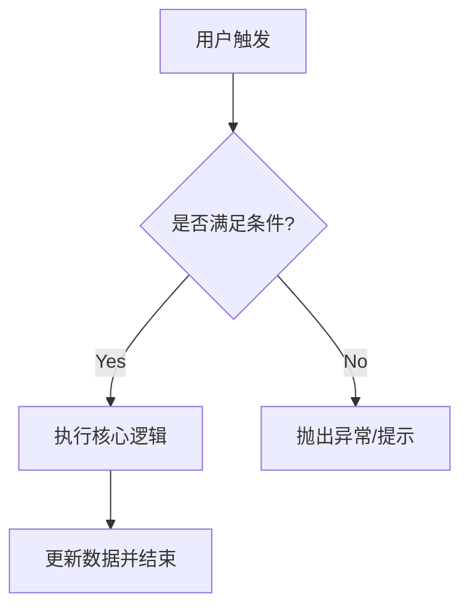
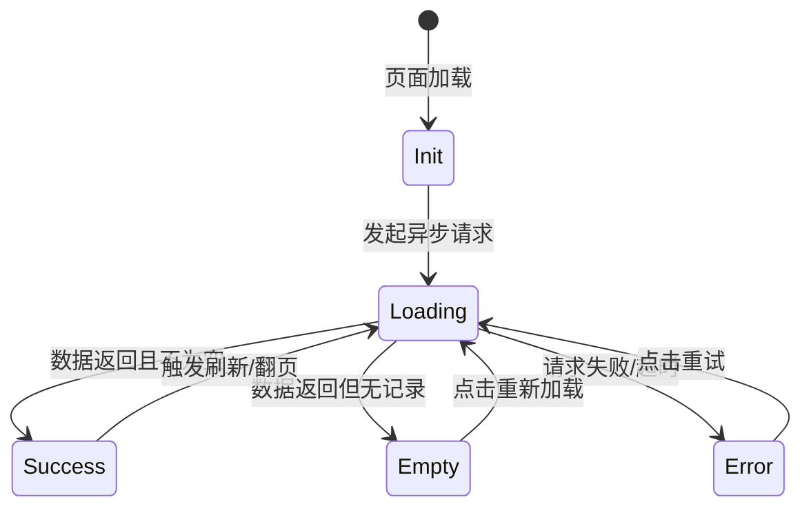

# 产品规格文件完整模板集

---

## 模板一：01-overview.spec.md（功能规格主文件）

```markdown
# 功能规格书 (Feature Specification): {模块英文名称}

## 1. 基础信息 (Metadata)
- **模块名称**: {例如：用户认证中心 / 订单管理}
- **标识符 (Module Key)**: {module_name}
- **版本号**: V1.0.0
- **全权负责人**: [产品经理姓名]
- **生效日期**: 2026-05-18

## 2. 功能愿景与核心目标 (Vision & Goal)
- **业务痛点**: {描述用户在什么场景下遇到了什么困难}
- **核心目标**: {通过本功能解决什么问题，预期的核心业务指标是什么}

## 3. 核心业务流程 (Core Business Process)



## 4. 核心功能需求清单 (Functional Requirements)

| 需求ID | 子功能名称 | 描述 | 涉及角色 | 优先级 (P0/P1) |
| --- | --- | --- | --- | --- |
| REQ-001 | 示例功能 | 当用户点击...时，系统应当... | 全部用户 | P0 |

## 5. 非功能性需求 (Non-Functional Requirements)

* **性能**: 核心 API 响应时间 $< 200\text{ms}$，支持并发 QPS $> 1000$。
* **安全性**: 密码必须使用 Argon2ID 强哈希加密传输与存储，防 SQL 注入。
* **国际化**: 支持中英双语，文案从 `i18n` 资源包读取。
```

---

## 模板二：02-user-stories.md（用户故事清单）

```markdown
# 用户故事清单 (User Stories): {模块英文名称}

> 💡 格式标准：作为 [某种角色], 我想 [做某件事], 以便 [获得什么业务价值]。

## [US-01] 故事主题一
- **故事描述**: 作为 **[角色]**, 我想 **[执行的操作]**, 以便 **[达到的目的]**。
- **业务场景示例**: {例如：小张作为运营，希望一键导出报表，不用再手动复制}
- **关联需求ID**: REQ-001

## [US-02] 故事主题二
- **故事描述**: 作为 **[角色]**, 我想 **[执行的操作]**, 以便 **[达到的目的]**
- **关联需求ID**: REQ-002
```

---

## 模板三：03-state-machine.md（验收标准）

```markdown
# 验收标准 (Acceptance Criteria): {模块英文名称}

> 💡 格式标准：严格采用 Given-When-Then (GWT) 自动化测试行为驱动语法。

## [AC-001] 功能点 A 的成功场景验收
- **场景描述**: 用户在提供正确完整信息时，操作成功
- **验收步骤**:
  - **Given (前提条件)**: 用户已登录系统，且账户余额 $> 100$ 元
  - **When (触发动作)**: 用户在输入框输入 `100`，并点击"确认提现"
  - **Then (预期结果)**: 系统提示"提现申请已提交"，账户余额变更为 `0` 元，数据库插入一条状态为 `PENDING` 的流水记录

## [AC-002] 功能点 A 的失败场景验收 (数据校验)
- **场景描述**: 用户输入非法数据时，系统拦截并友好提示
- **验收步骤**:
  - **Given (前提条件)**: 用户在提现页面
  - **When (触发动作)**: 用户输入 `-50` 或字符串 `abc`，点击"确认提现"
  - **Then (预期结果)**: 按钮置灰不可点击，输入框下方红字提示"请输入大于0的正整数"，不向后端发送请求
```

---

## 模板四：04-edge-cases.md（边界场景与异常处理）

```markdown
# 边界场景与异常矩阵 (Edge Cases): {模块英文名称}

## 1. 基础设施与网络级异常 (Infrastructure Failures)
- **[EC-001] 网络抖动/断网**: 
  - *处理机制*: 前端请求超时设定为 5s，超时后触发全局 Toast 提示"网络连接繁忙，请稍后再试"，严禁页面崩溃或无限 Loading。
- **[EC-002] 服务端 500/502 错误**:
  - *处理机制*: 降级路由到统一的 Error Page，并提供"重试"按钮。

## 2. 业务边界与并发异常 (Business Edge Cases)
- **[EC-003] 表单重复提交 (防重)**:
  - *处理机制*: 用户点击提交后，前端按钮立刻进入 `loading` + `disabled` 状态；后端基于 `Token/Idempotent-Key` 实现分布式幂等锁，锁定时长 3s。
- **[EC-004] 极值与大数据量注入**:
  - *处理机制*: 输入框限制最大字符长度 255，防止超长文本撑破 UI 布局或导致 SQL 溢出。
```

---

## 模板五：05-acceptance.md（状态流转图）

```markdown
# 界面与模块状态机 (Status Matrix): {模块英文名称}

## 1. 全局状态流转图 (Statechart)



## 2. 核心实体状态流转

```mermaid
stateDiagram-v2
    [*] --> {初始状态}: {触发条件}
    {状态A} --> {状态B}: {动作/事件}
    {状态B} --> {状态C}: {动作/事件}
```
```

---

## 填写注意事项

1. **{占位符} 必须替换为实际内容**，不能留空
2. **Mermaid 图必须反映实际业务**，不能使用通用占位流程
3. **REQ-ID / US-ID / AC-ID / EC-ID 必须一致关联**：
   - 用户故事中的 `关联需求ID` 对应 01-overview 中的 `需求ID`
   - 验收标准应覆盖用户故事中的场景
   - 边界场景应补充验收标准未覆盖的异常情况
4. **优先级标注规则**：P0 = 上线必须有，P1 = 体验优化可后续迭代
